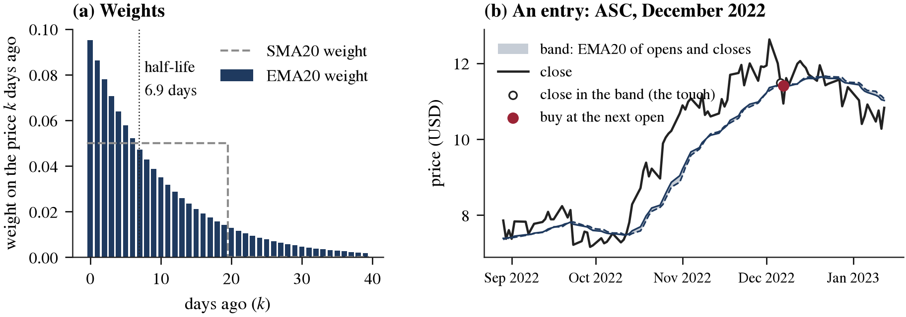
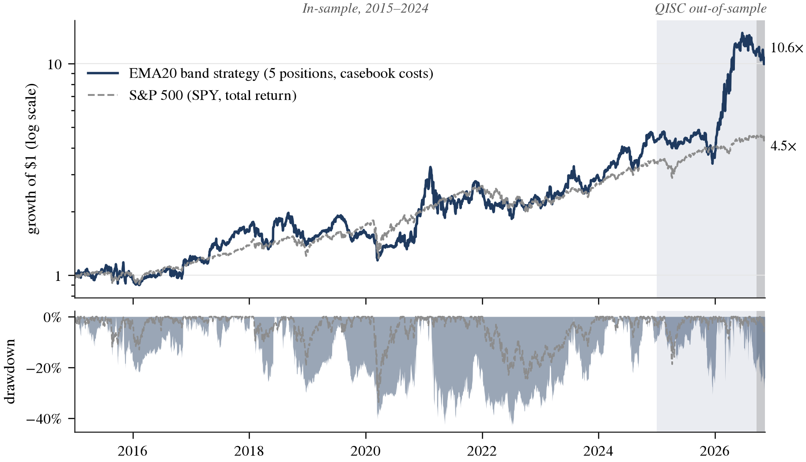
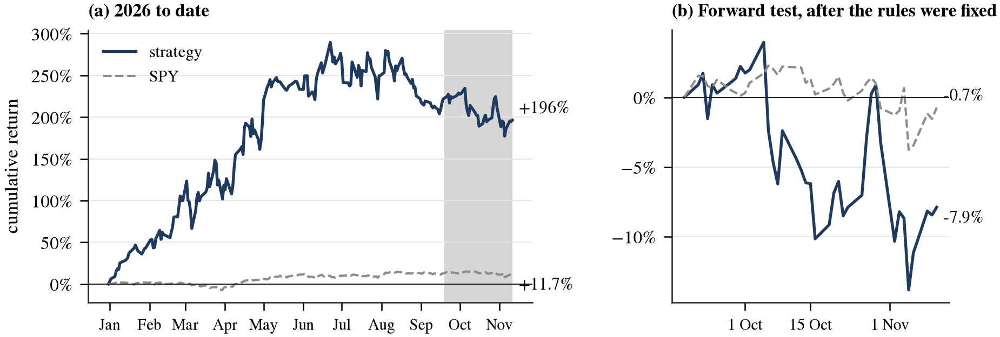
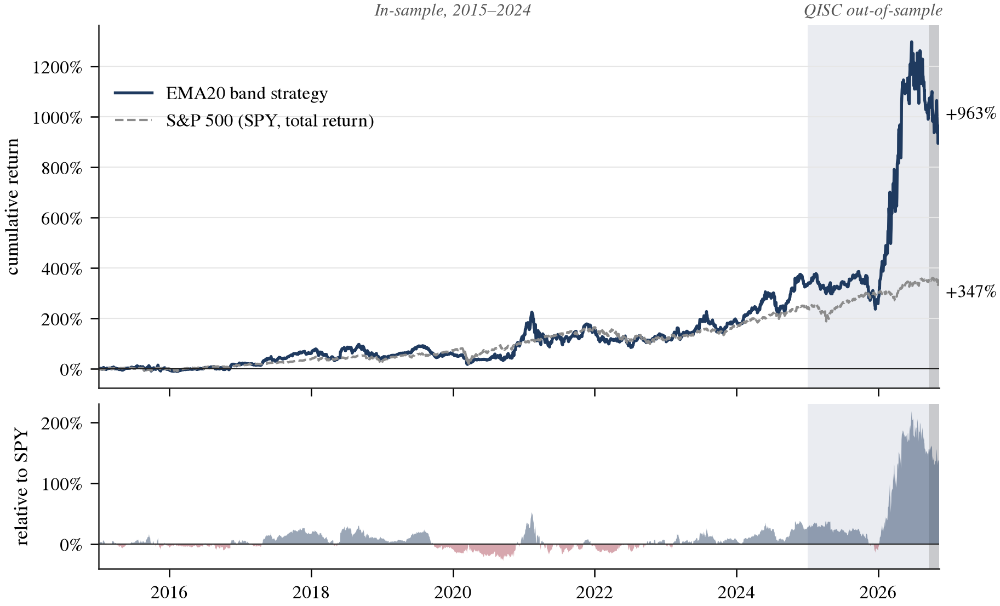
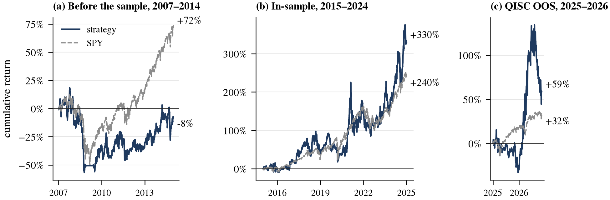
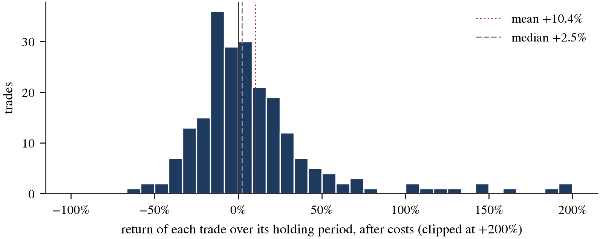
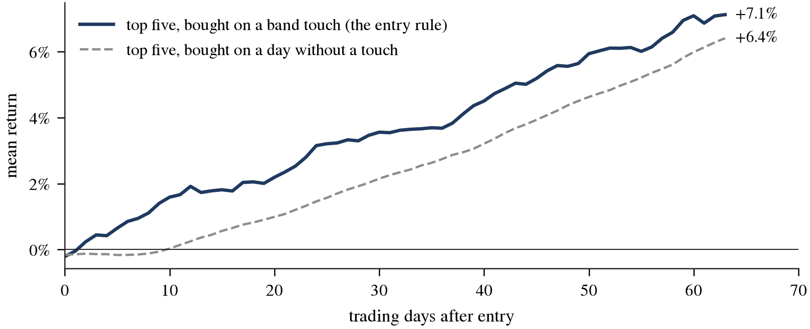
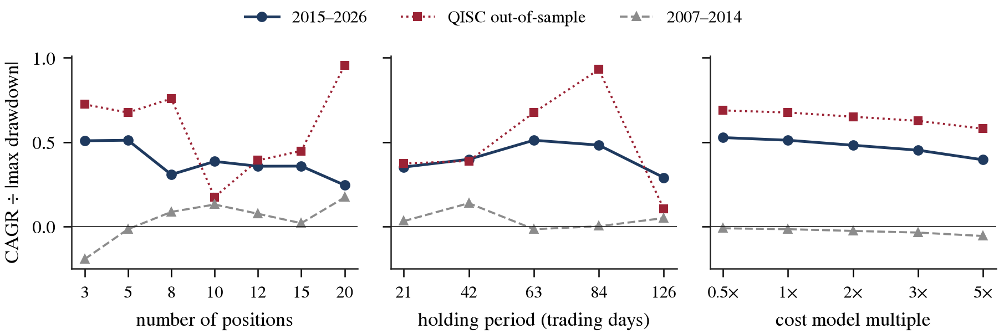

## Introduction

Buying a strong stock on a dip is among the most widely practised trading ideas and among the least rigorously tested. It combines two well-documented regularities. Over horizons of months, returns continue: stocks that have risen tend to keep rising (Jegadeesh and Titman, 1993; Moskowitz et al., 2012). Over days to weeks, returns partly reverse (Jegadeesh, 1990; Lehmann, 1990). An investor who selects strong trends but times the purchase to a short pullback should, in principle, earn the first premium at a better price because of the second.

We turn this idea into a fully specified, point-in-time strategy and evaluate it as the competition requires it to be traded. Each day we rank US stocks by the quality of their current trend, measured as the trend's return divided by its typical pullback. Among the five top-ranked stocks, we buy one when its price dips into the band between the 20-day exponential moving average (EMA) of opens and of closes and then closes back above it, and we sell every position after 63 trading days. Trading costs follow the QISC cost model, with fees and square-root market impact, and every order is capped at 5% of the stock's daily traded value. The main sample is the casebook's backtest period, January 2015 to November 2026. Because the rules were developed on data from July 2017 onward, we add two pieces of evidence that played no role in their design: the same rules over 2007–2014, and a forward test from 19 September 2026, when the rules were fixed.

The strategy works in the current regime. It earns 22.1% a year against 13.5% for the S&P 500, beats the index in seven of twelve calendar years and has gained 196% in 2026 to date. Its Sharpe ratio, 0.75, is close to the index's 0.81 and above what the best of the 51 variants we test would show by chance, but its monthly excess return is not statistically significant, the forward test has so far lost 7.9% against 0.7%, and over 2007–2014 the same rules lose money. We therefore study the regime directly. Since 2015 the market has trended more often, the screen has found more clean trends, and the winners have been larger. In tests specified before we ran them, three real-time indicators of this regime point the right way in both decades, but none is individually significant, and a rule that steps aside after a poor year cuts the 2007–2026 return from 10.9% to 3.8% a year. The timing rule, by contrast, holds in every sample: within the same month, touch entries beat entries into the same trends without one.

Section 2 sets out the economic rationale and hypotheses, Section 3 the data and sample design, and Section 4 the strategy and evaluation methods. Section 5 reports the results, including the forward test, Section 6 the robustness tests, and Section 7 the regime analysis and how we would detect decay. Section 8 covers implementation and risk, and Section 9 concludes.

## Economic rationale and hypotheses

### Mechanism

We classify the edge as behavioural, with a liquidity component. Momentum is commonly attributed to investors who underreact to gradually arriving information (Jegadeesh and Titman, 2001), and the disposition effect, the tendency to sell winners too early, is one channel through which such underreaction arises (Shefrin and Statman, 1985; Frazzini, 2006). Short-term reversal, in contrast, is largely compensation for supplying liquidity to investors who need to trade (Lehmann, 1990; Nagel, 2012). A pullback within a strong trend is where the two effects meet: the trend is intact, but the price has been pushed temporarily below it by selling unrelated to the firm's prospects. The counterparty on the entry day is a holder who sells into the dip, such as a trader taking profits, an investor selling a winner too early, or a trend-follower whose stop has been triggered. On the exit day, three months later, the typical counterparty is a later momentum buyer.

### Related evidence

Technical trading rules have a long and contested record. Moving-average rules appeared profitable on the Dow Jones index (Brock et al., 1992), but much of that evidence weakens once the number of rules searched is accounted for (Sullivan et al., 1999) and once transaction costs and false discoveries are controlled (Bajgrowicz and Scaillet, 2012). At the intraday horizon, none of 7,846 popular rules survives a data-snooping correction in US equities (Marshall et al., 2008). Cross-sectional moving-average signals have held up better (Han et al., 2013), and algorithmically identified retracement zones predict price bounces, although a bounce does not by itself imply a profitable strategy (Tsinaslanidis et al., 2022). Machine-learning studies routinely use moving averages as inputs (Patel et al., 2015; Sezer and Ozbayoglu, 2018) but rarely evaluate a complete, cost-aware portfolio. Momentum profits depend on the state of the market: they are concentrated after rising markets (Cooper et al., 2004) and crash in sharp rebounds after sell-offs (Daniel and Moskowitz, 2016). Factor returns themselves tend to continue (Ehsani and Linnainmaa, 2022), which would justify timing a strategy by its own recent performance. Against all of this, published anomalies decay (McLean and Pontiff, 2016), and rules selected after inspecting a sample overstate their future performance (Harvey et al., 2016).

### Hypotheses

The strategy makes a selection bet and a timing bet, and its performance may depend on the regime. We test four hypotheses.

*H1 (selection).* Stocks ranked in the top five by trend quality earn a positive return in excess of the equal-weighted eligible universe over the following 63 trading days.

*H2 (timing).* Within the same month, entries into top-ranked stocks on a band touch earn more over the following 5, 21 and 63 trading days than entries into top-ranked stocks without a touch.

*H3 (portfolio).* A five-position portfolio that combines both rules earns a positive return in excess of the S&P 500 after costs over 2015–2026 and in the QISC out-of-sample window.

*H4 (regime).* The portfolio's excess return differs between market regimes, and the regime can be identified in real time.

## Data and sample design

### Universe and prices

The universe starts from every security in the NASDAQ Trader symbol directory (November 2026) listed on NASDAQ, NYSE, NYSE American or NYSE Arca, excluding exchange-traded funds, test issues, warrants, rights, units, preferred shares and notes. Using the country and industry fields of the Nasdaq stock screener, we keep companies located in the United States and drop closed-end funds, which leaves 4,231 names. Daily open, high, low and close prices and volume come from Yahoo Finance, adjusted for splits and dividends, from January 2005 to 11 November 2026. On an average day about 40 stocks pass the trend screen. The benchmark is SPY with dividends reinvested. Zero and negative prices are set to missing, as is any open more than three times above or below the same day's close; no price is forward-filled. We focus on the US because the screen needs a large universe to find enough clean trends on any given day.

### Sample design

The rules were developed on data from July 2017 to 18 September 2026. Table 1 shows how the sample is divided and what each period can tell us.

| Period | Dates | Role |
|---|---|---|
| Main sample | 2 Jan 2015 to 11 Nov 2026 | The casebook's backtest period; all main results |
| In-sample | 2 Jan 2015 to 31 Dec 2024 | Overlaps the development data from July 2017 |
| QISC out-of-sample | 2 Jan 2025 to 11 Nov 2026 | The final 24 months required by the casebook; overlaps the development data up to September 2026 |
| Forward test | 19 Sep 2026 to 11 Nov 2026 | After the rules were fixed; the only period no design decision could have seen |
| Before the sample | 3 Jan 2007 to 31 Dec 2014 | Never used in development; the same rules in a different regime |

Table: Sample periods.

We report the QISC window separately, as the casebook requires, but it is not a clean out-of-sample test of these rules. The forward test is clean but short, and the years before the sample are clean but come from a different market. Section 7 uses both to ask whether the strategy's performance is a property of the current regime.

### Survivorship bias

The symbol directory lists only stocks that trade today, so delisted companies are missing. The bias favours the strategy, because the missing stocks are disproportionately those whose trends ended badly, and it grows with distance from the present. Results before 2015 are therefore an upper bound, which strengthens any negative conclusion drawn from them.

## Strategy and evaluation

### The EMA band

For a price series $x_t$, the exponential moving average with span $N$ is

$$E_t = \alpha x_t + (1-\alpha)E_{t-1} = \sum_{k\ge 0}\alpha(1-\alpha)^k x_{t-k}, \qquad \alpha = \frac{2}{N+1}. $$ (eq:ema)

With $N = 20$, today's price receives 9.5% of the weight and the weight halves every 6.9 trading days, so $E_t$ approximates the average price paid by the last month's buyers. We compute the EMA on opens ($E^O_t$) and on closes ($E^C_t$) and call the space between them the band, with upper edge $U_t = \max(E^O_t, E^C_t)$ and lower edge $L_t = \min(E^O_t, E^C_t)$. A close above the band is above where recent buyers both started and ended the day (Figure 1).

### Trend selection

A run starts on day $r(t)$, the first day after the latest stretch of more than ten consecutive closes below $E^C$. A stock passes the screen on day $t$ if its close is above $E^C_t$ and above the 100-day EMA of closes; the run has lasted at least 60 trading days and gained at least 5% in log terms; it contains at least two completed pullbacks of 5% or more, identified on closes with a zigzag filter; no single day contributes more than 20% of the run's log return and no five days more than 55%; and the price and liquidity floors are met. Stocks that pass are ranked by

$$\text{R/R}_t = \frac{C_t / C_{r(t)} - 1}{\lvert \bar{D}_t \rvert}, $$ (eq:rr)

where $C_t$ is the close and $\bar{D}_t$ the average depth of the completed pullbacks in the current run: the number of its own typical pullbacks the stock has gained. All quantities use prices up to day $t$, with one exception: a pullback whose low lies before $t$ is counted even if the 5% rebound that confirms it occurs after $t$. Section 6.4 removes this exception.

### Entry, exit, sizing and costs

A top-ranked stock generates an entry signal when, within the last five trading days, it closed inside the band or less than 1% above it, and today closes above the band:

$$\min_{s \in [t-4,\,t]} \left( \frac{C_s}{U_s} - 1 \right) \le 1\% \quad \text{and} \quad C_t > U_t. $$ (eq:touch)

Decisions are made at the close of day $t$ and executed at the open of day $t+1$. Each new position receives one fifth of current equity, capped by available cash and by 5% of the stock's 60-day median traded value, measured on a notional book that starts at $1 million and compounds. Every position is sold at the open 63 trading days after entry, and a stock sold in the previous five days cannot be bought again. Each order pays fees of 0.05% and market impact of $\max\left(0.05\%,\; 1\% \times \sqrt{Q / \text{ADV}}\right)$, where $Q$ is the order's value and ADV the 60-day median traded value. Uninvested cash earns nothing and the portfolio is not levered. Table 2 lists every parameter.

| Parameter | Value | Definition |
|---|---|---|
| Universe | US companies, no funds | Price at least $1; 60-day median traded value at least $0.5 million |
| Trend | EMA20 and EMA100 | Close above the 20-day and the 100-day EMA of closes |
| Run | > 10 closes; 60 days; +5% | Closes below EMA20 that end a run; minimum length and log return |
| Pullbacks | 2 of at least 5% | Zigzag reversals on closes within the current run |
| Gap filter | 20% / 55% | Maximum share of the run's log return from the best day / best five days |
| Ranking | Top 5 by R/R | Eq. (eq:rr) |
| Entry | 5 days, 1% | Window and tolerance of the band touch, Eq. (eq:touch) |
| Positions | 5 × 20% of equity | Long-only, unlevered |
| Liquidity | 5% of ADV | Maximum order size, on the compounding notional book |
| Exit | 63 trading days | Sold at the open; no other exit |
| Costs | Fees + impact | 0.05% fees; impact max(0.05%, 1% × √(Q / ADV)) per side |

Table: Parameters of the portfolio.

### Evaluation

We report the compound annual growth rate (CAGR), annualised volatility, Sharpe and Sortino ratios, maximum drawdown, and beta and annualised alpha from a regression of monthly returns on SPY. Sharpe ratios are computed from daily returns without subtracting a risk-free rate, for the strategy and the benchmark alike. Confidence intervals for the monthly excess return resample whole months 2,000 times. In the event study, a touch event is the first day of an entry signal for a top-ranked stock and a no-touch event is a day on which a top-ranked stock trends above the band without a recent touch, which corresponds to buying immediately. Returns run from the next open, net of 0.10% per side, and are also measured in excess of the equal-weighted eligible universe. Because no-touch events cluster in strong markets, we compare the two entries within each month and average the monthly differences.

The regime tests in Section 7 follow a protocol that we committed to the repository before running them. It fixes six indicators, each computed at a month-end from data available then and applied to the following month, the criterion for calling a regime identified, and the switching rules. Every variant in Sections 6 and 7 counts as a trial for the deflated Sharpe ratio of Bailey and López de Prado (2014).

## Results

### The portfolio, 2015–2026

Table 3 and Figure 2 report the portfolio over the main sample and by period. Over 2015–2026 it earns 22.1% a year against 13.5% for SPY and ends at 10.6 times its starting value against 4.5 times. Its Sharpe ratio, 0.75, is slightly below the index's 0.81, and its monthly excess return of 0.97% has an interval that includes zero. In the in-sample years it earns 15.7% a year against 13.0%; in the QISC out-of-sample window it earns 28.3% against 16.1%, with a drawdown of 42% against 19%. Before the sample it loses money, with a drawdown of 64% from October 2007 to October 2008. The excess return is positive in both periods of the main sample but distinguishable from zero in neither, so H3 is supported in direction but not in significance. Table A.1 adds two comparisons: over the development window alone the portfolio earns 28.4% a year, and a diversified ten-position version earns 16.7% over 2015–2026.

| Measure | 2015–2026 | 2015–2024 | 2025–2026 | 2007–2014 |
|---|---|---|---|---|
| *Panel A: Return* | | | | |
| CAGR | +22.1% | +15.7% | +28.3% | −1.1% |
| SPY CAGR | +13.5% | +13.0% | +16.1% | +7.0% |
| Monthly excess return | +0.97% | +0.44% | +1.68% | −0.50% |
| 95% interval | [−0.50%, +2.54%] | [−0.86%, +1.85%] | [−3.68%, +7.36%] | [−1.79%, +0.77%] |
| Alpha per year | +10.7% | +4.4% | +23.7% | −5.5% |
| Cumulative return (SPY) | +963% (+347%) | +330% (+240%) | +59% (+32%) | −8% (+72%) |
| *Panel B: Risk* | | | | |
| Volatility per year | 34.2% | 30.5% | 54.5% | 28.7% |
| Sharpe ratio (SPY) | 0.75 (0.81) | 0.63 (0.78) | 0.73 (0.96) | 0.11 (0.42) |
| Sortino ratio | 1.04 | 0.86 | 1.12 | 0.13 |
| Worst drawdown (SPY) | −43% (−34%) | −43% (−34%) | −42% (−19%) | −64% (−55%) |
| Beta | 1.10 | 1.07 | 0.91 | 0.97 |
| Information ratio | 0.37 | 0.20 | 0.43 | −0.27 |
| *Panel C: Trades* | | | | |
| Trades | 220 | 186 | 31 | 138 |
| Win rate | 52% | 51% | 55% | 50% |
| Average win / loss | +35.3% / −16.8% | +27.9% / −16.1% | +52.4% / −23.3% | +18.6% / −19.2% |
| Mean / median trade | +10.4% / +2.5% | +6.4% / +1.4% | +18.2% / +3.0% | −0.3% / −0.3% |

Table: Performance of the portfolio: main sample, in-sample years, QISC out-of-sample window and the years before the sample.
Note: Each column is a separate portfolio that starts in cash. Intervals resample whole months. Alpha and beta are from a regression of monthly returns on SPY. Annual returns are in Table A.3.

The portfolio moved broadly with the index until 2023, sometimes ahead and sometimes behind, and pulled clearly ahead in 2024 and 2026 (Figure 2). It beats SPY in seven of twelve calendar years, and its returns are concentrated in a few years and a few names: 2020 (+46.0%), 2024 (+47.2%) and 2026 to date (+196.4%). Trade returns are strongly skewed (Figure A.3): the median trade earns 2.5% and the mean 10.4%, eleven of 220 trades more than doubled, and 19 lost at least 30%. The ten best trades account for 74% of summed trade returns.

Realistic frictions matter for a concentrated strategy (Table A.2). With a flat 10 basis points per side and no limit on order size, the same rules earn 30.4% a year and their excess return is significant. Square-root impact costs remove 1.4 points, and capping each order at 5% of daily traded value removes about 7 more, because the strongest trends are often in stocks too thin to absorb a fifth of a growing portfolio.

### 2026 and the forward test

The portfolio has gained 196.4% in 2026 to date against 11.7% for SPY (Figure 3a). Most of the gain came between January and June, from a handful of semiconductor, storage and optical-networking stocks, and the portfolio has since fallen as much as 29% from its peak.

The rules were fixed on 18 September 2026. In the 38 trading days since, the portfolio has lost 7.9% while SPY lost 0.7% (Figure 3b). Six positions were held over the period (Table C.3): three lost about 24% each, three gained between 3% and 7%, and only one was opened after the rules were fixed. A shortfall of 7.2 points over 38 days is not unusual for this strategy: one in five 38-day windows in 2015–2026 was at least as bad. The forward test is therefore negative but not yet informative; the live evaluation that the competition runs after the submission deadline will extend it.

### The timing effect

Table 4 reports the event study. Over 63 trading days, touch entries earn 4.7 percentage points more than the equal-weighted universe and no-touch entries into the same top-ranked trends 4.1 points more; both intervals exclude zero, so H1 is supported in 2015–2026. Before the sample, neither group beats the universe.

| Sample and horizon | Touch: above universe [95%] | No touch: above universe [95%] | Touch minus no touch, same month [95%] |
|---|---|---|---|
| *Panel A: 2015–2026* | | | |
| 5 days | +0.3% [−0.3%, +0.9%] | −0.4% [−0.8%, +0.1%] | +1.6% [+0.7%, +2.6%] |
| 21 days | +1.8% [+0.4%, +3.4%] | +0.3% [−1.1%, +1.7%] | +3.2% [+1.7%, +4.9%] |
| 63 days | +4.7% [+1.7%, +7.9%] | +4.1% [+1.0%, +7.5%] | +5.1% [+1.7%, +8.9%] |
| *Panel B: By period, 5 days* | | | |
| 2015–2024 | +0.3% [−0.3%, +1.0%] | −0.4% [−0.8%, −0.0%] | +1.8% [+0.9%, +2.9%] |
| 2025–2026 | +0.1% [−1.5%, +1.9%] | −0.0% [−1.4%, +1.2%] | +0.4% [−1.8%, +2.4%] |
| 2007–2014 | −0.5% [−1.2%, −0.0%] | −0.2% [−0.6%, +0.3%] | +0.7% [+0.0%, +1.3%] |
| *Panel C: By period, 63 days* | | | |
| 2015–2024 | +4.1% [+1.6%, +6.8%] | +2.0% [−0.5%, +4.2%] | +4.7% [+1.6%, +7.9%] |
| 2025–2026 | +8.6% [−5.5%, +26.8%] | +15.8% [−0.4%, +32.6%] | +7.7% [−5.8%, +26.5%] |
| 2007–2014 | −0.7% [−3.5%, +2.2%] | −1.4% [−3.7%, +1.0%] | +2.6% [−0.8%, +5.7%] |

Table: Event study: entries into top-five stocks with and without a band touch.
Note: 1,327 touch and 9,570 no-touch events in 2015–2026. Returns run from the next open, net of 0.10% per side. "Above universe" subtracts the equal-weighted return of all eligible stocks over the same days. The last column is the mean over months of the within-month difference between touch and no-touch returns; it compares raw returns.

The timing effect (H2) is the most robust result in the paper. Within the same month, touch entries beat no-touch entries by 1.6 percentage points over five days, 3.2 over 21 days and 5.1 over 63 days, with every interval excluding zero. Before the sample the effect is smaller but still positive at five and 21 days (+0.7 and +1.5 points, both intervals just above zero), and it has the same sign in the out-of-sample window, where less than two years of events leave the intervals wide. In pooled averages (Figure A.4) the gap is smaller, 0.7 points at 63 days, because no-touch entries cluster in strong markets.

## Robustness

### Exit rules

Table B.1 compares eight alternative exits on the same entries. None improves on the 63-day clock. Exits on closes below the band earn 4.0% to 15.4% a year; stop-losses at 25% and 40% earn about 17%, consistent with the mixed evidence on stop-losses in long-only portfolios (Lei and Li, 2009; Kaminski and Lo, 2014); and an exit on a heavy-volume down day earns 22.8% with a deeper drawdown of 53%.

### Position count, holding period and costs

Table B.2 and Figure B.1 vary one parameter at a time. Concentration pays in this sample: three to five positions earn 22% to 25% a year and eight or more 12% to 17%, with no smaller drawdown; before 2015, more positions reduce losses. Holding periods of 42 to 84 days earn 21% to 22%, and 21 or 126 days about 16%. The portfolio trades about 7.4 times its capital a year, counting purchases and sales, at an average cost of 0.18% per side, so doubling the cost model lowers the CAGR to 21.3% and five times the cost model to 18.9%.

### Entry parameters

Table B.3 varies the touch window, the tolerance above the band and the EMA span. Requiring a close strictly inside the band raises the CAGR to 27.0%, and the strict touch is the best tolerance for every window. The pattern is not monotonic, however: a 1% tolerance is worse than both 0% and 2% in every window. A five-position portfolio is path-dependent, since one missed entry changes every later one, so we read the grid as noise around a positive effect and do not switch to the strict touch after seeing it. Spans from 10 to 40 days give CAGRs between 15.1% and 22.1%, with the 20-day span at the top, as expected of a parameter chosen on these data.

### Stress tests

Table B.4 reports the stress tests described in the casebook and three further checks. Delaying every trade by one day lowers the return to 20.2% a year, and counting pullbacks only once confirmed to 21.1%. Removing the five largest contributors (AXTI, SNDK, NUTX, APPS and CELH) lowers it to 12.0%, below the index. Buying the same stocks without waiting for a touch earns 17.3% with a drawdown of 57%, and loses 12.3% a year in the out-of-sample window against a gain of 28.3% for the portfolio: the timing rule is what separates the two. Starting the portfolio in different months of 2015 gives CAGRs between 18.3% and 26.7%.

### Multiple testing

Sections 6 and 7 report 51 variants, counting the baseline each time it appears. If none had any true edge, the expected maximum annualised Sharpe ratio across 51 trials with the observed dispersion would be 0.24. The deflated Sharpe ratio of the portfolio, the probability that its true Sharpe ratio exceeds that benchmark after allowing for skewness and fat tails, is 0.961, above the conventional 0.95. The portfolio's risk-adjusted return is therefore unlikely to be an artefact of the variants we tried; it is not, however, higher than the index's.

## Regime and decay

### What changed after 2015

Figure 4 runs the same rules continuously from 2007 and plots the monitors defined in the protocol. The portfolio's three-year return relative to SPY was negative at nearly every month-end from 2010 to 2018, positive for short spells in 2019 and 2021, and positive almost continuously since late 2022. Table 5 shows how the market differed between the periods.

| Measure | 2007–2014 | 2015–2024 | 2025–2026 |
|---|---|---|---|
| Stocks passing the trend screen per day | 35 | 44 | 39 |
| Days with SPY above its 200-day average | 64% | 82% | 88% |
| Equal-weighted universe minus SPY, per year | +3.7% | −3.6% | −8.5% |
| Trades | 143 | 189 | 29 |
| Trades in technology / health care | 6% / 15% | 16% / 17% | 21% / 24% |
| Median trade | +0.7% | +1.4% | +6.7% |
| Trades returning +50% or more | 3.5% | 9.0% | 17.2% |
| Touch minus no touch at 21 days, same month | +1.5% | +3.0% | +4.4% |

Table: Market conditions and the portfolio's trades by period.
Note: Trades are from the same rules run continuously from 2007. Sectors are from the Nasdaq stock screener.

Three differences stand out. The market trended more: SPY spent 82% to 88% of days above its 200-day average after 2015, against 64% before, a period that includes the 2008 crisis and the 2011 sell-off. The screen found more clean trends, and the trades it produced were more often extreme winners: 9% to 17% of trades returned 50% or more, against 3.5% before. And the timing effect itself was two to three times stronger. The current regime is not one of broad small-cap strength, since the equal-weighted universe has lagged SPY since 2015; it is a trending market in which a few stocks, increasingly in technology and health care, make very large moves.

### Can the regime be identified in real time?

Table 6 reports Test 1 of the protocol: the portfolio's return above SPY in the month after each indicator is on, minus the same return after it is off. The protocol calls a regime identified if the difference is positive both before and within the sample and the pooled interval excludes zero.

| Indicator | 2007–2014 [95%] | 2015–2026 [95%] | Pooled [95%] |
|---|---|---|---|
| R1 Market trend | +1.72% [−1.64%, +5.23%] | +0.49% [−2.48%, +3.41%] | +1.26% [−1.01%, +3.57%] |
| R2 Supply of clean trends | +1.36% [−1.31%, +4.08%] | +1.88% [−1.17%, +5.00%] | +1.63% [−0.59%, +3.78%] |
| R3 Small-cap leadership | +1.14% [−1.59%, +3.95%] | +2.28% [−1.15%, +6.16%] | +1.30% [−0.99%, +3.52%] |
| R4 Strategy momentum | −5.78% [−8.28%, −3.34%] | −1.03% [−4.14%, +2.14%] | −2.05% [−4.24%, +0.02%] |
| R5 Edge health | +1.62% [−2.28%, +5.15%] | −0.79% [−6.26%, +3.99%] | +0.52% [−2.94%, +3.61%] |
| R6 R4 and R5 both on | −5.08% [−7.53%, −2.45%] | −0.44% [−3.71%, +2.74%] | −1.22% [−3.61%, +1.04%] |

Table: Next-month return above SPY with each regime indicator on, minus the same with it off.
Note: Percentage points per month; intervals resample months within each group. On when: R1, SPY is above its 200-day average; R2, the number of stocks passing the screen is above its 3-year median; R3, the equal-weighted universe has beaten SPY over 6 months; R4, the portfolio has beaten SPY over 12 months; R5, the month-matched touch advantage was positive over the past year. No indicator meets the protocol's criterion.

No indicator meets the criterion, so H4 is not supported in its strict form. Three indicators point the right way in both decades: the portfolio did 0.5 to 2.3 points a month better after the market trended (R1), after the supply of clean trends was above its median (R2) and after small stocks led (R3). With about 85 months before the sample and 143 within it, none of these differences is significant on its own. The strategy's own recent performance points the wrong way: after a year in which it beat SPY, it did worse in the following month, by 5.8 points before the sample, where the interval excludes zero, and by 1.0 point within it. Factor returns in general continue (Ehsani and Linnainmaa, 2022), but this strategy's returns reverse, plausibly because a good year for a five-stock book is made by a few large winners that are then sold.

### Walk-forward switching rules

Table 7 reports Test 2: each rule holds the portfolio in a month when its indicator was on at the previous month-end and SPY otherwise. Every decision uses data available at the time, no threshold is fitted, and each switch costs 0.25%.

| Rule | CAGR, 2007–2014 | CAGR, 2015–2026 | CAGR, 2007–2026 | Sharpe, 2007–2026 | Worst drawdown | Monthly excess [95%] |
|---|---|---|---|---|---|---|
| Always invested | −1.1% | +19.9% | +10.9% | 0.48 | −64% | +0.33% [−0.73%, +1.38%] |
| R1 Market trend | +4.8% | +18.5% | +12.8% | 0.53 | −56% | +0.43% [−0.53%, +1.42%] |
| R2 Clean trends | +4.5% | +20.9% | +14.0% | 0.57 | −63% | +0.50% [−0.39%, +1.44%] |
| R3 Small caps | +4.0% | +21.4% | +14.1% | 0.62 | −63% | +0.39% [−0.31%, +1.17%] |
| R4 Momentum | −8.6% | +13.1% | +3.8% | 0.27 | −74% | −0.43% [−1.12%, +0.23%] |
| R5 Edge health | +4.0% | +17.7% | +12.0% | 0.52 | −53% | +0.33% [−0.54%, +1.27%] |
| R6 R4 and R5 | −4.6% | +14.4% | +6.3% | 0.36 | −64% | −0.23% [−0.89%, +0.39%] |
| SPY | +7.0% | +13.5% | +10.8% | 0.62 | −55% | |

Table: Walk-forward rules that hold SPY instead of the portfolio when an indicator is off.
Note: The portfolio runs continuously from 2007 as a shadow book, so its returns in 2015–2026 differ slightly from Table 3, where it starts in cash in January 2015.

The three structural indicators help. Each turns the years before the sample from a loss of 1.1% a year into a gain of 4.0% to 4.8%, still below SPY's 7.0%, and leaves 2015–2026 roughly unchanged; over 2007–2026 they raise the CAGR from 10.9% to between 12.8% and 14.1%. The small-cap rule brings the Sharpe ratio up to the index's, 0.62. None makes the excess return significant. The rules based on the strategy's own performance destroy value: stepping aside after a year behind SPY cuts the 2007–2026 return to 3.8%.

### Detecting decay

The tests suggest how to decide when the strategy has stopped working. First, do not switch off on recent performance. Rules R4 and R6 would have taken the strategy out after its losing years and put it back after its winning years, the wrong way round in both decades. A drawdown measured against the index is no better: the continuous book fell 41% behind SPY by 2009 and 72% behind by 2020, and regained its 2007 relative peak only in April 2026 (Figure 4d), so a relative-drawdown stop would have ended the strategy before every one of its good years. Second, monitor the conditions the strategy needs. Market trend (R1) and the supply of clean trends (R2) measure whether the market is producing the trends the screen looks for; when both were off, as in 2008, late 2011, late 2015 to early 2016 and most of 2022, the strategy had little to work with. Third, monitor the mechanism. Edge health (R5) measures whether the timing effect still works. It was negative in 2008–2009 and briefly in 2019–2021, and has been positive since 2022. It reacts too slowly to time the portfolio, but a year of negative readings would mean that the pullback entry has stopped adding value, the clearest sign of decay this strategy can give.

Because no indicator met the protocol's criterion, we do not add a filter to the submitted strategy. We would report the three monitors monthly and stop trading if edge health is negative for twelve consecutive months or the drawdown exceeds 55%, deeper than any start month in 2015 produced (47% at worst).

### How the regime could end

Three developments would end the current regime. A prolonged bear or range-bound market, as in 2008 or 2011–2012, would reduce the number of clean trends and break more of those that remain; R1 and R2 would show it within a month or two. A reversal of the themes behind the largest winners would hit a five-stock book hard: the 2026 gains came from a few semiconductor, storage and optical-networking stocks, and the portfolio has already fallen as much as 29% from its 2026 peak. And a sharp rebound after a sell-off, when momentum strategies crash (Daniel and Moskowitz, 2016), would hurt a strategy that buys the strongest trends. If pullback buying in strong trends became crowded, the timing effect could also shrink, as published anomalies tend to (McLean and Pontiff, 2016); edge health would show this, slowly.

## Implementation and risk

**Capacity.** The median order is 1.8% of the stock's 60-day median traded value, and 28% of orders are cut back by the 5% cap. The median stock bought trades $25.8 million a day and the 5th percentile $1.0 million, where the cap limits a position to about $50,000. The cap binds more as the book compounds and already costs about 7 points a year (Table A.2).

**Execution.** All trades are market-on-open orders placed after the previous close, at an average cost of 0.18% per side, most of it market impact in the smaller names. Returns therefore combine overnight and intraday components, which respond differently to news (Bahcivan, 2025).

**Risk.** Beta is 1.10 and volatility 34%, about twice that of SPY. Investors should expect drawdowns of 40% to 65% and about one trade in twelve to lose 30% or more, and without its five largest contributors the portfolio would have trailed the index. Volatility scaling, which helps conventional momentum portfolios (Barroso and Santa-Clara, 2015), is a natural next test.

## Conclusion

This strategy works in the current regime. Under the QISC rules it earns 22.1% a year from 2015 to 2026 against 13.5% for the S&P 500, with a Sharpe ratio close to the index's and a risk-adjusted return that survives a correction for the 51 variants we tested. It does not work before 2015, and the regime that suits it, a trending market that produces many clean trends and a few extreme winners, is clear in hindsight. In tests we specified in advance, three real-time indicators of that regime point the right way in both decades but none is significant on its own, so we do not claim that the regime can yet be timed. The forward test since the rules were fixed is negative, though not unusually so.

Two results are robust enough to act on. The pullback entry improves on buying the same trends without a pullback in every sample, by about 1.6 points over a week and 5 points over three months since 2015. And the strategy's own recent performance is the wrong signal for deciding when to stop: monitoring the market conditions it needs and the timing effect it relies on is better. We would run the strategy as a concentrated satellite position with those monitors, and treat the competition's live evaluation as its next test.

## Statement of Originality and AI Disclosure

We declare that this paper and the accompanying code are the original work of Team [Team Name], that all sources are cited, and that the submission has not been submitted to any other competition. Generative AI was used to assist with programming the data pipeline and with formatting tables and figures. The strategy, the analysis and the written paper are the team's own work, and the team takes full responsibility for the content.

## Code and data availability

The repository `qisc-[team-name]` reproduces every table and figure with one command, `python run.py`. It downloads the symbol directory, the Nasdaq screener and the prices, computes the point-in-time scores, runs every test, and writes the tables, the figures, the trade list and `output/positions.csv` in the format required by the competition. `REGIME_PROTOCOL.md` contains the regime tests as committed before they were run. All data are publicly available; a full run takes about 30 minutes, most of it the price download.

## References

REF: Bahcivan, H., 2025. Day and night expected returns under overnight information shocks: new tug-of-war pattern. *Finance Research Letters* 86, 108591.
REF: Bailey, D.H., López de Prado, M., 2014. The deflated Sharpe ratio: correcting for selection bias, backtest overfitting, and non-normality. *Journal of Portfolio Management* 40 (5), 94–107.
REF: Bajgrowicz, P., Scaillet, O., 2012. Technical trading revisited: false discoveries, persistence tests, and transaction costs. *Journal of Financial Economics* 106 (3), 473–491.
REF: Barroso, P., Santa-Clara, P., 2015. Momentum has its moments. *Journal of Financial Economics* 116 (1), 111–120.
REF: Brock, W., Lakonishok, J., LeBaron, B., 1992. Simple technical trading rules and the stochastic properties of stock returns. *Journal of Finance* 47 (5), 1731–1764.
REF: Cooper, M.J., Gutierrez, R.C., Hameed, A., 2004. Market states and momentum. *Journal of Finance* 59 (3), 1345–1365.
REF: Daniel, K., Moskowitz, T.J., 2016. Momentum crashes. *Journal of Financial Economics* 122 (2), 221–247.
REF: Ehsani, S., Linnainmaa, J.T., 2022. Factor momentum and the momentum factor. *Journal of Finance* 77 (3), 1877–1919.
REF: Frazzini, A., 2006. The disposition effect and underreaction to news. *Journal of Finance* 61 (4), 2017–2046.
REF: Han, Y., Yang, K., Zhou, G., 2013. A new anomaly: the cross-sectional profitability of technical analysis. *Journal of Financial and Quantitative Analysis* 48 (5), 1433–1461.
REF: Harvey, C.R., Liu, Y., Zhu, H., 2016. … and the cross-section of expected returns. *Review of Financial Studies* 29 (1), 5–68.
REF: Jegadeesh, N., 1990. Evidence of predictable behavior of security returns. *Journal of Finance* 45 (3), 881–898.
REF: Jegadeesh, N., Titman, S., 1993. Returns to buying winners and selling losers: implications for stock market efficiency. *Journal of Finance* 48 (1), 65–91.
REF: Jegadeesh, N., Titman, S., 2001. Profitability of momentum strategies: an evaluation of alternative explanations. *Journal of Finance* 56 (2), 699–720.
REF: Kaminski, K.M., Lo, A.W., 2014. When do stop-loss rules stop losses? *Journal of Financial Markets* 18, 234–254.
REF: Lehmann, B.N., 1990. Fads, martingales, and market efficiency. *Quarterly Journal of Economics* 105 (1), 1–28.
REF: Lei, A.Y.T., Li, H., 2009. The value of stop loss strategies. *Financial Services Review* 18 (1), 23–51.
REF: Marshall, B.R., Cahan, R.H., Cahan, J.M., 2008. Does intraday technical analysis in the U.S. equity market have value? *Journal of Empirical Finance* 15, 199–210.
REF: McLean, R.D., Pontiff, J., 2016. Does academic research destroy stock return predictability? *Journal of Finance* 71 (1), 5–32.
REF: Moskowitz, T.J., Ooi, Y.H., Pedersen, L.H., 2012. Time series momentum. *Journal of Financial Economics* 104 (2), 228–250.
REF: Nagel, S., 2012. Evaporating liquidity. *Review of Financial Studies* 25 (7), 2005–2039.
REF: Patel, J., Shah, S., Thakkar, P., Kotecha, K., 2015. Predicting stock and stock price index movement using trend deterministic data preparation and machine learning techniques. *Expert Systems with Applications* 42, 259–268.
REF: Sezer, O.B., Ozbayoglu, A.M., 2018. Algorithmic financial trading with deep convolutional neural networks: time series to image conversion approach. *Applied Soft Computing* 70, 525–538.
REF: Shefrin, H., Statman, M., 1985. The disposition to sell winners too early and ride losers too long: theory and evidence. *Journal of Finance* 40 (3), 777–790.
REF: Sullivan, R., Timmermann, A., White, H., 1999. Data-snooping, technical trading rule performance, and the bootstrap. *Journal of Finance* 54 (5), 1647–1691.
REF: Tsinaslanidis, P., Guijarro, F., Voukelatos, N., 2022. Automatic identification and evaluation of Fibonacci retracements: empirical evidence from three equity markets. *Expert Systems with Applications* 187, 115893.

## Appendix A. Additional results

Table A.1 compares the portfolio with the development window, a diversified version and the years before the sample. Table A.2 shows the effect of the casebook's cost model and liquidity cap. Table A.3 lists calendar-year returns of the portfolio from 2015 and of the same rules run continuously from 2007. Figures A.1 and A.2 show cumulative returns against SPY, Figure A.3 the distribution of trade returns, and Figure A.4 the average path after touch and no-touch entries.

| Measure | Portfolio, 2015–2026 | Development window, 2017–2026 | Ten positions, 2015–2026 | Same rules, 2007–2014 |
|---|---|---|---|---|
| Trades | 220 | 171 | 435 | 138 |
| Win rate | 52% | 56% | 53% | 50% |
| Growth per year (SPY) | +22.1% (+13.5%) | +28.4% (+15.0%) | +16.7% (+13.5%) | −1.1% (+7.0%) |
| Sharpe ratio (SPY) | 0.75 (0.81) | 0.85 (0.85) | 0.67 (0.81) | 0.11 (0.42) |
| Worst drawdown (SPY) | −43% (−34%) | −45% (−34%) | −43% (−34%) | −64% (−55%) |
| Monthly return above SPY | +0.97% | +1.38% | +0.40% | −0.50% |
| 95% interval | [−0.50%, +2.54%] | [−0.43%, +3.38%] | [−0.65%, +1.43%] | [−1.79%, +0.77%] |
| Cumulative return (SPY) | +963% (+347%) | +896% (+262%) | +524% (+347%) | −8% (+72%) |

Table: The portfolio, the development window, a diversified version and the years before the sample.
Note: The development window runs from 3 July 2017 to 18 September 2026. Each column is a separate portfolio that starts in cash.

| Cost and liquidity assumptions | Per year | Worst drawdown | Sharpe | Monthly excess [95%] |
|---|---|---|---|---|
| Flat 10 bp per side, no liquidity cap | +30.4% | −47% | 0.87 | +1.72% [+0.04%, +3.50%] |
| Impact costs, no liquidity cap | +29.0% | −48% | 0.84 | +1.63% [−0.05%, +3.41%] |
| Flat 10 bp per side, orders capped at 5% of ADV | +22.5% | −43% | 0.77 | +1.00% [−0.47%, +2.56%] |
| Impact costs and 5% of ADV cap (the portfolio) | +22.1% | −43% | 0.75 | +0.97% [−0.50%, +2.54%] |

Table: The effect of trading costs and the liquidity cap, January 2015 to November 2026.

| Year | Portfolio, from 2015 | Same rules, from 2007 | SPY | Portfolio minus SPY |
|---|---|---|---|---|
| 2007 | | +8.8% | +5.3% | |
| 2008 | | −54.7% | −36.8% | |
| 2009 | | +32.7% | +26.4% | |
| 2010 | | +4.7% | +15.1% | |
| 2011 | | −7.5% | +1.9% | |
| 2012 | | +4.7% | +16.0% | |
| 2013 | | +22.4% | +32.3% | |
| 2014 | | +13.0% | +13.5% | |
| 2015 | −4.5% | −11.0% | +1.2% | −5.7% |
| 2016 | +23.4% | +5.0% | +12.0% | +11.4% |
| 2017 | +36.3% | +39.9% | +21.7% | +14.6% |
| 2018 | −9.8% | −18.0% | −4.6% | −5.3% |
| 2019 | +10.5% | +12.3% | +31.2% | −20.7% |
| 2020 | +46.0% | +57.0% | +18.3% | +27.7% |
| 2021 | +10.5% | +9.4% | +28.7% | −18.3% |
| 2022 | −13.4% | −17.4% | −18.2% | +4.8% |
| 2023 | +30.7% | +34.3% | +26.2% | +4.5% |
| 2024 | +47.2% | +51.5% | +24.9% | +22.3% |
| 2025 | −16.6% | −16.4% | +17.7% | −34.4% |
| 2026* | +196.4% | +195.4% | +11.7% | +184.7% |

Table: Calendar-year returns.
Note: The portfolio starts in cash on 2 January 2015 and beats SPY in seven of twelve years; the same rules run continuously from 2007 hold different positions in 2015 and drift apart from it. * 2026 to 11 November.

## Appendix B. Robustness tables

| Exit rule (entries unchanged) | Trades | Win rate | Per year | Worst drawdown | CAGR ÷ drawdown | Sharpe |
|---|---|---|---|---|---|---|
| Hold 63 days (baseline) | 220 | 52% | +22.1% | −43% | 0.51 | 0.75 |
| Close below the band | 929 | 31% | +4.0% | −48% | 0.08 | 0.28 |
| Three closes below the band | 607 | 38% | +13.7% | −51% | 0.27 | 0.57 |
| Five closes below the band | 483 | 36% | +15.4% | −47% | 0.32 | 0.62 |
| Heavy-volume down day (≥ 3×) | 316 | 53% | +22.8% | −53% | 0.43 | 0.79 |
| Heavy-volume down day (≥ 5×) | 251 | 53% | +14.6% | −55% | 0.27 | 0.58 |
| Three closes below the band or volume ≥ 3× | 673 | 40% | +15.4% | −50% | 0.31 | 0.63 |
| Stop at −25% | 253 | 49% | +17.1% | −55% | 0.31 | 0.64 |
| Stop at −40% | 229 | 50% | +17.6% | −47% | 0.38 | 0.66 |

Table: Exit rules, January 2015 to November 2026.
Note: Exits other than the clock are decided on a close and executed at the next open; every position is sold after 63 days at the latest. Heavy-volume down day: a lower close on volume of at least the stated multiple of its 50-day median.

| Variant | Trades | Per year | Worst drawdown | Sharpe | CAGR ÷ drawdown: 2015–2026 | 2015–2024 | 2025–2026 | 2007–2014 |
|---|---|---|---|---|---|---|---|---|
| *Panel A: Number of positions* | | | | | | | | |
| 3 | 130 | +25.4% | −50% | 0.81 | 0.51 | 0.40 | 0.72 | −0.19 |
| 5 (baseline) | 220 | +22.1% | −43% | 0.75 | 0.51 | 0.36 | 0.68 | −0.02 |
| 8 | 352 | +14.5% | −47% | 0.58 | 0.31 | 0.22 | 0.76 | 0.09 |
| 10 | 435 | +16.7% | −43% | 0.67 | 0.39 | 0.34 | 0.17 | 0.13 |
| 12 | 518 | +15.3% | −43% | 0.64 | 0.36 | 0.34 | 0.39 | 0.07 |
| 15 | 647 | +15.7% | −44% | 0.66 | 0.36 | 0.29 | 0.45 | 0.02 |
| 20 | 846 | +11.9% | −49% | 0.55 | 0.24 | 0.18 | 0.95 | 0.17 |
| *Panel B: Holding period (trading days)* | | | | | | | | |
| 21 | 550 | +16.2% | −46% | 0.67 | 0.35 | 0.33 | 0.37 | 0.03 |
| 42 | 317 | +20.9% | −52% | 0.77 | 0.40 | 0.32 | 0.39 | 0.14 |
| 63 (baseline) | 220 | +22.1% | −43% | 0.75 | 0.51 | 0.36 | 0.68 | −0.02 |
| 84 | 169 | +22.0% | −46% | 0.75 | 0.48 | 0.44 | 0.93 | 0.00 |
| 126 | 115 | +15.8% | −55% | 0.61 | 0.29 | 0.29 | 0.10 | 0.05 |
| *Panel C: Cost model multiple* | | | | | | | | |
| 0.5× | 220 | +22.4% | −43% | 0.76 | 0.53 | 0.38 | 0.69 | −0.01 |
| 1× (baseline) | 220 | +22.1% | −43% | 0.75 | 0.51 | 0.36 | 0.68 | −0.02 |
| 2× | 220 | +21.3% | −44% | 0.73 | 0.48 | 0.34 | 0.65 | −0.03 |
| 3× | 220 | +20.6% | −46% | 0.71 | 0.45 | 0.31 | 0.63 | −0.04 |
| 5× | 220 | +18.9% | −48% | 0.67 | 0.39 | 0.27 | 0.58 | −0.06 |

Table: Position count, holding period and costs.
Note: Each row changes one parameter of the baseline. Panel C scales both fees and market impact. The last four columns are separate portfolios per period.

| Touch window or EMA span | Tolerance | Trades | Per year | Worst drawdown | CAGR ÷ drawdown | Sharpe |
|---|---|---|---|---|---|---|
| *Panel A: Touch window* | | | | | | |
| 3 days | 0% | 203 | +16.5% | −43% | 0.39 | 0.61 |
| 3 days | 1% | 215 | +12.8% | −45% | 0.28 | 0.53 |
| 3 days | 2% | 221 | +14.5% | −44% | 0.33 | 0.57 |
| 5 days | 0% | 212 | +27.0% | −38% | 0.71 | 0.90 |
| 5 days (baseline) | 1% | 220 | +22.1% | −43% | 0.51 | 0.75 |
| 5 days | 2% | 226 | +26.4% | −39% | 0.68 | 0.87 |
| 10 days | 0% | 220 | +18.6% | −40% | 0.47 | 0.68 |
| 10 days | 1% | 225 | +14.5% | −53% | 0.27 | 0.56 |
| 10 days | 2% | 228 | +16.3% | −44% | 0.37 | 0.61 |
| *Panel B: EMA span of the band* | | | | | | |
| 10 days | 1% | 230 | +15.1% | −55% | 0.27 | 0.57 |
| 15 days | 1% | 225 | +16.4% | −44% | 0.38 | 0.61 |
| 20 days (baseline) | 1% | 220 | +22.1% | −43% | 0.51 | 0.75 |
| 30 days | 1% | 198 | +20.4% | −46% | 0.44 | 0.73 |
| 40 days | 1% | 176 | +16.7% | −46% | 0.36 | 0.65 |

Table: Entry parameters, January 2015 to November 2026.
Note: Panel B keeps the five-day window. The trend screen is unchanged throughout.

| Test | Per year | Worst drawdown | Sharpe | Monthly excess [95%] |
|---|---|---|---|---|
| Portfolio | +22.1% | −43% | 0.75 | +0.97% [−0.5%, +2.5%] |
| Execution one day later | +20.2% | −46% | 0.70 | +0.88% [−0.6%, +2.6%] |
| Without the five largest contributors | +12.0% | −45% | 0.52 | +0.10% [−1.1%, +1.4%] |
| Bought without a touch | +17.3% | −57% | 0.61 | +0.62% [−0.8%, +2.1%] |
| Pullbacks counted only once confirmed | +21.1% | −50% | 0.73 | +0.92% [−0.6%, +2.5%] |
| New positions only while SPY is above its 200-day average | +14.7% | −52% | 0.57 | +0.40% [−1.1%, +2.0%] |
| Twelve start months in 2015 | +18.3% to +26.7% | −47% to −42% | | |
| Twelve start months in 2007, to 2014 | −4.8% to +5.2% | −69% to −49% | | |

Table: Stress tests, January 2015 to November 2026.

## Appendix C. Trades

The full list of 220 trades is in `output/trades.csv`. Prices are split- and dividend-adjusted opens; returns are after fees and market impact. Open positions are marked at the close of 11 November 2026, before exit costs.

{{trades:../output/tables/trades_best.csv | The ten best trades, 2015–2026.}}

{{trades:../output/tables/trades_worst.csv | The ten worst trades, 2015–2026.}}

{{trades:../output/tables/trades_forward.csv | Every position held in the forward test, 19 September to 11 November 2026.}}

{{trades:../output/tables/trades_oos.csv | Every trade entered in the QISC out-of-sample window and closed by 11 November 2026.}}
