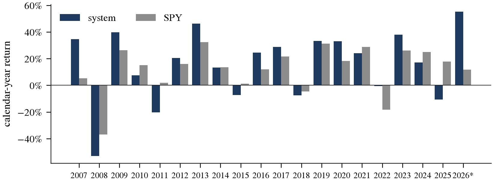

## Introduction

Few trading ideas are as widely practised, and as rarely tested with discipline, as buying a strong stock on a dip. The idea combines two of the best-documented regularities in equity returns. Over months, trends persist: stocks that have risen tend to keep rising (Jegadeesh and Titman, 1993; Moskowitz et al., 2012). Over days to weeks, prices partly reverse (Jegadeesh, 1990; Lehmann, 1990). An investor who selects stocks in strong trends but times the purchase to a short pullback should, in principle, collect the first effect at a better price because of the second.

SEE Lab (2026) turns this idea into a fully specified system. Each day it ranks US stocks by the quality of their current trend, measured as the return of the trend divided by its typical pullback. It allows only the five highest-ranked stocks, buys one when its price dips into the band between the 20-day exponential moving average (EMA) of opens and of closes and then closes back above it, and sells every position after 63 trading days. Over July 2017 to September 2026 the system is reported to have grown by 41.9% a year after costs, against 15.0% for the S&P 500, turning $1 into $25.0.

A result of that size invites four questions, which organise this paper. First, does it replicate when the data are rebuilt independently? Second, does it survive the constraints that an investable portfolio, and this competition, impose: smaller positions, a liquidity floor and higher trading costs? Third, does it hold outside the period on which its rules were designed? Fourth, if the system does not hold up as a whole, which of its components do?

We answer them with a public-data replication and a battery of tests. We rebuild the price panel from the NASDAQ Trader symbol directory, the Nasdaq stock screener and Yahoo Finance, and implement the trend screen, the entry signal and the portfolio simulation exactly as specified in the original code. In its own sample the replication matches the original closely: 171 trades against 170, 39.1% a year against 41.9%, and the same largest trade, AXTI bought on 3 February 2026 for a gain of 389.7%. We then make three changes required by the QISC casebook: ten positions of at most 10% of capital instead of five of 20%, a $2 million daily liquidity floor, and costs of 10 basis points per side instead of five. We extend the sample back to January 2007, which adds a pre-design decade that the rule designer never saw, and forward to November 2026.

The findings are mixed, and we report them as such. The compliant book earns 12.4% a year from 2007 to 2026, against 10.8% for the S&P 500, but with more risk: its Sharpe ratio is 0.54 against 0.62 for the index, its worst drawdown is 58%, and its monthly excess return is not significantly different from zero. It beats the index only in the period on which the rules were designed; it trails it in the decade before and in the QISC out-of-sample window. Even the original rules, unchanged, earn 13.6% a year over the full twenty years. Several claims of the original paper do not transfer to the longer sample: the fixed 63-day exit is not the best exit, and five positions is not the best portfolio size. One component is robust: the pullback entry. Compared within the same month, entries on a band touch outperform entries into the same top-ranked trends without one by 1.1 percentage points over five days and 2.3 points over three months, and both effects are significant in the pre-design decade.

The paper contributes in three ways. It provides an independent replication of a recent practitioner strategy with publicly available data, and identifies the one data choice on which the replication depends. It shows, in a single setting, how much of a backtest's return can disappear under realistic constraints, an earlier sample and a correction for multiple testing (Harvey et al., 2016; Bailey and López de Prado, 2014). And it separates a robust timing effect from a fragile portfolio result, which suggests where further research on this strategy should concentrate.

The rest of the paper is organised as follows. Section 2 states the hypotheses and their economic rationale. Section 3 describes the data and Section 4 the methodology. Section 5 reports the replication, the performance of the QISC book and the event study. Section 6 presents the robustness tests, Section 7 discusses implementation and risk, and Section 8 concludes.

## Hypothesis and economic rationale

### Hypotheses

The system makes two separate bets, and we test them separately. The first is a selection bet: that stocks with the highest-quality current trends outperform. The second is a timing bet: that among those stocks, buying after a pullback is better than buying at an arbitrary point in the trend. We state three falsifiable hypotheses.

*H1 (selection).* Stocks ranked in the top ten by trend quality earn a positive return in excess of the equal-weighted eligible universe over the following 63 trading days.

*H2 (timing).* Within the same month, entries into top-ranked stocks on a band touch earn more over the following 5, 21 and 63 trading days than entries into top-ranked stocks without a touch.

*H3 (portfolio).* A ten-position book that combines the selection and the timing rule earns a positive risk-adjusted return in excess of the S&P 500 after costs, in the QISC out-of-sample window and in the pre-design decade, not only in the period in which the rules were designed.

### Source of the edge

We classify the edge as behavioural, with a liquidity component. Momentum is commonly attributed to investors who underreact to gradually arriving information (Jegadeesh and Titman, 2001), and the disposition effect, the tendency to sell winners too early, is one mechanism that produces such underreaction (Shefrin and Statman, 1985; Frazzini, 2006). Short-term reversal, in contrast, is largely compensation for providing liquidity to investors who need to trade (Lehmann, 1990; Nagel, 2012). A pullback within a strong trend is the point at which these two effects meet: the trend is still in place, and the price has been pushed temporarily below it by selling that is unrelated to the stock's prospects.

Technical trading rules have a long and contested history. Simple moving-average rules appeared profitable on the Dow Jones index (Brock et al., 1992), but much of that evidence weakens once the number of rules searched is taken into account (Sullivan et al., 1999) and once transaction costs and false discoveries are controlled for (Bajgrowicz and Scaillet, 2012). Cross-sectional versions of moving-average signals, which compare stocks with each other rather than time a single index, have held up better (Han et al., 2013). The EMA20 band system is cross-sectional in its selection step and time-series in its entry step, which makes it a natural setting in which to separate the two.

### Who is on the other side

On the entry day, the seller is a holder who sells into a dip: a short-term trader taking profits, an investor who sells a winner too early, or a trend-follower whose stop has been triggered. These sellers are not wrong that the price has fallen, but on average they are early to leave a trend that continues. On the exit day, three months later, the typical buyer is a later momentum investor who buys after the stock has risen further.

### Why the edge may not persist

Three forces work against the strategy. First, momentum is vulnerable to crashes: it performs worst when markets rebound sharply after a decline, and long-only momentum portfolios lose heavily in broad sell-offs (Daniel and Moskowitz, 2016). Second, anomalies that are published and traded tend to weaken (McLean and Pontiff, 2016). Third, rules chosen after inspecting a sample tend to look better in that sample than they will out of it, and the more variants are tried, the larger the gap (Harvey et al., 2016). Our design addresses the third force directly by evaluating the rules on a decade they were not designed on and by correcting for every variant we test.

### Why the US arena

The system needs a large universe to find enough clean trends at any time: on an average day, only about 40 of nearly 3,800 eligible US stocks pass its trend screen. The US market also offers long daily histories, deep liquidity and low trading costs, and it is the market on which the original system was developed, which makes a like-for-like replication possible. The same logic could be applied on the IDX, but its smaller set of liquid stocks, the long-only constraint and the auto-rejection limits would leave few candidates on most days. We leave that test to future work.

## Data

### Universe and prices

The universe starts from every security in the NASDAQ Trader symbol directory as of November 2026 that is listed on NASDAQ, NYSE, NYSE American or NYSE Arca, excluding exchange-traded funds, test issues, warrants, rights, units, preferred shares and notes, which leaves 5,593 securities. The original code then keeps only companies located in the United States and excludes closed-end funds. We apply the same filter with the country and industry fields of the Nasdaq stock screener, which removes 1,284 foreign companies and 78 closed-end funds and leaves 4,231 names. For each we download daily open, high, low and close prices and volume from Yahoo Finance from January 2005 to 11 November 2026, adjusted for splits and dividends. Of these names, 3,793 reach a price of at least $1 and a 60-day median traded value of at least $0.5 million at some point, and only these can ever be selected. The benchmark is the SPY exchange-traded fund, also adjusted for dividends, so that its returns are total returns.

### Cleaning

We apply the cleaning rules of the original code without modification. Zero and negative prices are set to missing. An open that is more than three times above or below the same day's close is treated as a data error and set to missing, so that the simulator cannot trade at it. No price is forward-filled: a position whose stock has no price on a given day keeps its last valuation, and a trade cannot be executed until a valid open is available.

### Sample periods

We divide the sample into three periods, defined by what the designer of the rules could have seen (Table 1). The scores require 200 trading days of history, so the first decisions are made in January 2007.

| Period | Dates | Role |
|---|---|---|
| Pre-design | 3 Jan 2007 to 30 Jun 2017 | Never used in designing the rules; the cleanest out-of-sample test |
| Design | 1 Jul 2017 to 31 Dec 2024 | The rules were developed on data that include this period |
| QISC out-of-sample | 1 Jan 2025 to 11 Nov 2026 | The final 24 months required by the casebook; partly seen by the designer, whose sample ends in September 2026 |

Table: Sample periods.

The QISC out-of-sample window is the one the competition requires, and we report it separately throughout. It is, however, not untouched: the original rules were finalised on data that end in September 2026. We therefore regard the pre-design decade, which includes the 2008 financial crisis, as the more informative out-of-sample test.

### Survivorship bias

The symbol directory lists only stocks that trade today, so companies that were delisted after bankruptcy, acquisition or a failed listing are missing. The original data share this limitation. The bias works in the strategy's favour, because the missing stocks are disproportionately the ones whose trends ended badly, and it grows with the distance from the present: a stock that was trending in 2008 and is still listed in 2026 is, by construction, a survivor. Results for the pre-design decade are therefore an upper bound on what the strategy would have earned, which strengthens rather than weakens any negative conclusion drawn from that period.

## Methodology

### The exponential moving average band

For a price series $x_t$, the exponential moving average with span $N$ is

$$E_t = \alpha x_t + (1-\alpha)E_{t-1} = \sum_{k\ge 0}\alpha(1-\alpha)^k x_{t-k}, \qquad \alpha = \frac{2}{N+1}. $$ (eq:ema)

With $N = 20$, $\alpha \approx 0.095$: today's price receives 9.5% of the weight, and the weight halves every 6.9 trading days, so $E_t$ approximates the average price paid by the last month's buyers. The EMA is computed twice, on opens ($E^O_t$) and on closes ($E^C_t$), and the space between them is the band, with upper edge $U_t = \max(E^O_t, E^C_t)$ and lower edge $L_t = \min(E^O_t, E^C_t)$. A close above both lines means that the stock trades above where recent buyers started the day and where they ended it. Figure 1 shows the weights and an entry from the sample.

### Trend selection

A trend, or run, starts on day $r(t)$, the first day after the last stretch of more than ten consecutive closes below $E^C$. On day $t$, a stock passes the screen if all of the following hold: its close is above $E^C_t$ and above the 100-day EMA of closes; the run has lasted at least 60 trading days and gained at least 5% in log terms; it contains at least two completed pullbacks of 5% or more, identified on closing prices with a zigzag filter; no single day contributes more than 20% of the run's log return and the best five days no more than 55%; the price is at least $1; and the 60-day median traded value is at least $0.5 million. The gap conditions exclude runs built on a few jumps rather than steady accumulation. Stocks that pass are ranked by the reward-to-risk ratio

$$\text{R/R}_t = \frac{C_t / C_{r(t)} - 1}{\lvert \bar{D}_t \rvert}, $$ (eq:rr)

where $C_t$ is the close and $\bar{D}_t$ the average depth of the completed pullbacks in the current run. The ratio measures how many of its own typical pullbacks the stock has gained. Prices after day $t$ are not used, with one exception inherited from the original code: a pullback whose low lies before day $t$ is counted even if the 5% rebound that confirms it occurs after $t$. Section 6.4 shows that removing this exception does not change the conclusions.

### Entry, exit and portfolio construction

A stock in the day's top ranks generates an entry signal when, within the last five trading days, it closed inside the band or less than 1% above it, and today closes above the band:

$$\min_{s \in [t-4,\,t]} \left( \frac{C_s}{U_s} - 1 \right) \le 1\% \quad \text{and} \quad C_t > U_t. $$ (eq:touch)

The decision is made at the close of day $t$ and executed at the open of day $t+1$. Each position is sold at the open 63 trading days after entry, with no other exit. A stock sold in the last five days cannot be bought again. Positions are not added to or trimmed while held, and uninvested cash earns no interest, which is conservative. Table 2 lists the rules of the original system and the three changes that the QISC casebook requires.

| Element | SEE Lab (2026) | QISC book (this paper) |
|---|---|---|
| Universe | US companies; no funds; price ≥ $1 | Unchanged |
| Ranking and signal | Top five by R/R, band touch, Eq. (eq:touch) | Top ten by R/R, band touch, Eq. (eq:touch) |
| Positions | Five slots of 20% of equity | Ten slots of 10% of equity (casebook limit: 10% per name) |
| Liquidity | Median traded value of at least $0.5 million a day | At least $2 million a day, so that a $100,000 position is at most 5% of it |
| Costs | 5 bp per side | 10 bp per side: 5 bp fees and 5 bp slippage (casebook minimum) |
| Execution | Close of $t$, open of $t+1$ | Unchanged |
| Exit | Open after 63 trading days | Unchanged |
| Direction and leverage | Long-only, unlevered | Unchanged |

Table: The trading rules of the original system and of the QISC-compliant book.

### Evaluation

We report the compound annual growth rate (CAGR), annualised volatility, the Sharpe and Sortino ratios, the maximum drawdown, the ratio of CAGR to the absolute maximum drawdown, and beta and annualised alpha from a regression of monthly book returns on monthly SPY returns. Sharpe ratios are computed from daily returns without subtracting a risk-free rate, for the strategy and the benchmark alike, so that the two are directly comparable. For the monthly return in excess of SPY we report a 95% confidence interval obtained by resampling whole months 2,000 times, which preserves the clustering of returns within months.

For the event study, every first day of a signal episode for a top-ranked stock is an event. A touch event is a day on which the entry rule in Eq. (eq:touch) fires; a no-touch event is a day on which a top-ranked stock is in a trend without a recent touch, which corresponds to buying immediately. For each event we measure the return from the next open to the open 5, 21 and 63 trading days later, net of costs, and the same return in excess of the equal-weighted eligible universe. Because no-touch events cluster in months when many stocks are trending, pooled averages mix the effect of timing with that of market conditions. We therefore also compute, for each month, the difference between the average touch and no-touch return, and report the mean of those monthly differences with a bootstrap interval.

Finally, every variant reported in Section 6 is counted as a trial, and we compute the deflated Sharpe ratio of Bailey and López de Prado (2014) for the main book, which adjusts its Sharpe ratio for the number of trials and the non-normality of returns.

## Results

### Replication of the original result

Table 3 compares our replication with the original paper. We use the original specification, five slots, the original liquidity gate and 5 bp per side, over the original sample period. The trade count matches within one, the annual return within three percentage points, and the monthly excess return over SPY within a quarter of a point, with an interval that likewise excludes zero. The largest trade is identical: AXTI, bought on 3 February 2026, gains 389.7% in both. The remaining gap is expected: the two price panels were downloaded at different dates from sources that revise their adjustments, and in a five-position book a single trade that is or is not taken moves the annual return by several points.

| Measure | SEE Lab (2026) | Our replication |
|---|---|---|
| Trades | 170 | 171 |
| Win rate | 53% | 56% |
| Growth per year | +41.9% | +39.1% |
| Worst drawdown | −41% | −47% |
| CAGR ÷ max drawdown | 1.01 | 0.84 |
| $1 becomes | $25.0 | $20.9 |
| Monthly return above SPY [95% interval] | +2.44% [+0.54%, +4.54%] | +2.23% [+0.18%, +4.51%] |
| S&P 500 growth per year | +15.0% | +15.0% |

Table: Replication of the original result: five slots, 5 bp per side, July 2017 to September 2026.

One data choice matters a great deal. The original code applies its country filter through a screener file that is not part of its repository. Without the filter, the same rules earn 33.7% a year instead of 39.1%, because foreign listings occupy slots and displace, or delay, some of the largest US winners. A replication that skips this step would understate the original result by a quarter.

The same original specification run over the full 2007–2026 sample earns 13.6% a year with a worst drawdown of 70%, against 10.8% a year for SPY. The drawdown occurs in 2008, when the five-position book lost more than two thirds of its value.

### Performance of the QISC book

Table 4 reports the performance of the QISC-compliant book over the full sample and in each period, and Figure 2 shows its growth and drawdown. Over nearly twenty years, the book turns $1 into $10.18 against $7.67 for SPY: 12.4% a year against 10.8%. It does so with a beta of 0.97 and an annualised volatility of 29.6%, about one and a half times that of the index, so its Sharpe ratio of 0.54 is below SPY's 0.62, and its worst drawdown, 58% from October 2007 to July 2009, is deeper than SPY's 55%. The monthly excess return is +0.29%, with a 95% interval of −0.48% to +1.05%.

| Measure | Full sample | Pre-design | Design | QISC out-of-sample |
|---|---|---|---|---|
| *Panel A: Return* | | | | |
| Growth per year (CAGR) | +12.4% | +6.3% | +17.8% | +10.7% |
| S&P 500 growth per year | +10.8% | +7.5% | +14.4% | +16.1% |
| Monthly return above SPY | +0.29% | −0.01% | +0.48% | −0.00% |
| 95% interval | [−0.48%, +1.05%] | [−0.94%, +0.91%] | [−0.85%, +1.91%] | [−3.72%, +3.85%] |
| Alpha per year | +3.8% | +1.0% | +4.7% | −5.4% |
| $1 becomes (SPY) | $10.18 ($7.67) | $1.90 ($2.13) | $3.42 ($2.74) | $1.21 ($1.32) |
| *Panel B: Risk* | | | | |
| Volatility per year | 29.6% | 24.2% | 31.8% | 45.0% |
| Sharpe ratio (SPY) | 0.54 (0.62) | 0.37 (0.45) | 0.68 (0.81) | 0.45 (0.96) |
| Sortino ratio | 0.71 | 0.48 | 0.86 | 0.63 |
| Worst drawdown (SPY) | −58% (−55%) | −58% (−55%) | −52% (−34%) | −35% (−19%) |
| CAGR ÷ max drawdown | 0.21 | 0.11 | 0.34 | 0.30 |
| Beta | 0.97 | 0.86 | 1.08 | 1.39 |
| Information ratio | 0.16 | −0.01 | 0.25 | −0.00 |
| *Panel C: Trades* | | | | |
| Trades | 710 | 366 | 265 | 62 |
| Win rate | 54% | 54% | 54% | 50% |
| Average win / average loss | +22.4% / −16.3% | +18.1% / −15.5% | +25.4% / −16.9% | +35.8% / −21.6% |
| Mean / median trade | +4.4% / +2.0% | +2.5% / +1.6% | +6.0% / +2.1% | +7.1% / −0.9% |

Table: Performance of the QISC book, January 2007 to November 2026.
Note: Each period is a separate book that starts in cash on the first day of the period. Ten slots, $2 million liquidity floor, 10 bp per side. Intervals resample whole months. Alpha and beta are from a regression of monthly returns on SPY.

The periods tell a consistent story. In the pre-design decade the book trails the index, 6.3% a year against 7.5%, with a lower Sharpe ratio and a deeper worst drawdown (58% against 55%). In the design period it beats the index, 17.8% against 14.4%, but with a Sharpe ratio of 0.68 against 0.81 and a drawdown of 52% against 34%. In the QISC out-of-sample window it trails again, 10.7% against 16.1%, with a beta of 1.39. In none of the four columns can the excess return be distinguished from zero. Hypothesis H3 is therefore not supported: the system beats the market only in the period on which it was designed.

Figure 3 shows the returns by calendar year. The book beats SPY in eleven of twenty years. Its worst absolute years are 2008 (−53.0% against −36.8% for SPY) and 2011 (−20.2% against +1.9%), years in which trends broke abruptly. Its largest shortfalls relative to the index are in 2025, 2011 and 2008, and its largest gains in 2026, 2007 and 2022.

### Trades and concentration

The book made 710 trades in 529 different stocks. The distribution of their returns is strongly skewed (Figure 4). The median trade earns 2.0% and the mean 4.4%. Seven trades more than doubled, and 52 lost 30% or more. The ten best trades account for 44% of the summed trade returns, and the five stocks that contributed most (AXTI, PACB, CRDF, APPS and LITE) account for 28%. Section 6.4 shows what happens when they are removed.

### Does the pullback add value?

Table 5 reports the event study. Over 63 trading days, touch entries earn 5.1% on average, 2.6 percentage points more than the equal-weighted universe. No-touch entries into the same top-ranked trends earn 4.2%, or 2.0 points above the universe. Both intervals exclude zero, so the selection effect on its own (H1) is positive, but it is concentrated in the design period: in the pre-design decade neither group beats the universe significantly.

| Horizon | Touch: return | Touch: above universe [95%] | No touch: return | No touch: above universe [95%] | Touch minus no touch, same month [95%] |
|---|---|---|---|---|---|
| *Panel A: Full sample* | | | | | |
| 5 days | +0.3% | +0.1% [−0.2%, +0.4%] | −0.0% | −0.2% [−0.4%, +0.1%] | +1.1% [+0.7%, +1.5%] |
| 21 days | +1.5% | +0.9% [+0.2%, +1.6%] | +1.0% | +0.3% [−0.5%, +1.2%] | +1.7% [+1.0%, +2.5%] |
| 63 days | +5.1% | +2.6% [+1.1%, +4.3%] | +4.2% | +2.0% [+0.4%, +3.7%] | +2.3% [+1.0%, +3.5%] |
| *Panel B: By period, 5 days* | | | | | |
| Pre-design | +0.2% | −0.1% [−0.4%, +0.2%] | −0.1% | −0.3% [−0.6%, −0.0%] | +1.0% [+0.7%, +1.4%] |
| Design | +0.3% | +0.3% [−0.2%, +0.8%] | +0.0% | −0.1% [−0.5%, +0.3%] | +1.2% [+0.4%, +2.1%] |
| QISC out-of-sample | +0.5% | +0.5% [−0.8%, +1.8%] | +0.1% | +0.0% [−1.2%, +1.1%] | +0.7% [−0.6%, +2.1%] |
| *Panel C: By period, 63 days* | | | | | |
| Pre-design | +3.9% | +1.2% [−0.4%, +2.8%] | +2.2% | −0.1% [−1.5%, +1.2%] | +2.1% [+0.2%, +3.9%] |
| Design | +5.5% | +3.5% [+1.1%, +5.9%] | +4.2% | +2.5% [+0.4%, +4.6%] | +2.6% [+0.8%, +4.5%] |
| QISC out-of-sample | +11.0% | +8.0% [−2.8%, +20.7%] | +13.8% | +10.8% [−0.9%, +22.8%] | +1.8% [−1.9%, +5.7%] |

Table: Event study: entries into top-ten stocks with and without a band touch.
Note: Full sample: 4,163 touch events and 26,983 no-touch events. Returns run from the next open, net of 10 bp per side. "Above universe" subtracts the equal-weighted return of all eligible stocks over the same days. The last column averages, over months, the difference between the mean touch and the mean no-touch return within each month (226 to 229 months in the full sample).

The timing effect (H2) is clearer. Compared within the same month, touch entries beat no-touch entries by 1.1 percentage points over five days, 1.7 points over 21 days and 2.3 points over 63 days, and all three intervals exclude zero. Most importantly, the effect is significant in the pre-design decade, which the rule designer never saw: +1.0 points over five days and +2.1 points over 63 days. It has the same sign in the out-of-sample window, where the intervals are wide because only 23 months are available. Figure 5 shows the pooled averages, in which the gap between the two entries widens steadily over the holding period, to 0.9 points at 63 days. The pooled gap is smaller than the month-matched one because no-touch entries are concentrated in strong markets, when many stocks are trending at once.

## Robustness

### Exit rules

The original paper argues that a fixed 63-day exit beats every price-based exit, because the return arrives slowly, because a few large winners pay for everything, and because price exits cannot tell a pullback from the end of a trend. Table B.1 in Appendix B repeats that comparison for the QISC book over the full sample. The ranking only partly transfers. Exits that respond to closes below the band remain clearly worse, consistent with the original argument. But a 40% stop-loss raises the CAGR from 12.4% to 14.8% and the ratio of CAGR to drawdown from 0.21 to 0.29, and an exit on a heavy-volume down day, a close below the previous day's close on at least three times the 50-day median volume, does almost as well. We do not adopt either: both were selected after seeing the results and would need their own out-of-sample test. The point is that the claim that time is the best exit is specific to the original sample.

### Portfolio size, holding period and costs

Figure 6 and Table B.2 in Appendix B vary the number of positions, the holding period and the trading cost one at a time. No setting changes the conclusion. With three positions the book loses 87% at its worst; with five, the original choice, it earns 12.8% a year with a 71% drawdown. More positions mainly reduce the drawdown: twenty positions give the highest ratio of CAGR to drawdown, 0.28, with a drawdown of 45%. The ranking of portfolio sizes differs from period to period, and the original finding that five slots is best does not hold. The holding period matters little between 42 and 126 days; 21 days is clearly worse. Costs matter little at all: the book trades about 7.2 times its capital a year, counting purchases and sales together, so each additional basis point per side costs roughly 0.07 percentage points a year, and even 50 bp per side leaves 9.4% a year.

### Entry parameters

Table B.3 in Appendix B varies the two parameters of the touch condition, the window in which the touch must occur and how far above the band a close may be and still count, and the span of the EMA that defines the band. The trend screen is left unchanged. The original setting, a five-day window and a 1% tolerance, is not the best cell: a ten-day window with a close strictly inside the band raises the CAGR to 15.9%. But neighbouring cells do not follow a smooth pattern, and the best tolerance differs from one window to the next, which is the signature of noise rather than of a better parameter. The EMA span matters somewhat more: spans from 10 to 40 days give CAGRs between 8.0% and 14.5%, with the shortest span clearly the worst.

### Stress tests

Table 6 collects the stress tests that the QISC casebook describes, together with four further checks. Delaying every trade by one day slightly improves the result (13.0% against 12.4% a year), so the result does not depend on executing at the first possible open. Removing the five stocks that contributed most lowers the return to 11.7% a year and the monthly excess return to +0.22%. Buying the top-ranked stocks without waiting for a touch earns 11.9% a year over the full sample and only 0.7% a year in the out-of-sample window, against 10.7% for the touch book: the timing rule is what separates the two. Counting a pullback only once it is confirmed, which removes the one use of later prices described in Section 4.2, lowers the return to 10.4% a year, almost all of it in the design period (15.7% against 17.8%), and leaves every conclusion unchanged. Starting the book in a different month changes the CAGR of the pre-design decade from 3.3% to 7.6% and that of the design period from 12.0% to 18.7%, a reminder that a single backtest path carries considerable luck.

| Test | Per year | Worst drawdown | Sharpe | Monthly excess [95%] |
|---|---|---|---|---|
| QISC book | +12.4% | −58% | 0.54 | +0.29% [−0.5%, +1.1%] |
| Execution one day later | +13.0% | −56% | 0.56 | +0.32% [−0.5%, +1.1%] |
| Without the five largest contributors | +11.7% | −58% | 0.53 | +0.22% [−0.5%, +1.0%] |
| Bought without a touch | +11.9% | −58% | 0.51 | +0.32% [−0.6%, +1.2%] |
| Pullbacks counted only once confirmed | +10.4% | −58% | 0.48 | +0.15% [−0.7%, +0.9%] |
| New positions only while SPY is above its 200-day average | +13.2% | −54% | 0.59 | +0.32% [−0.5%, +1.1%] |
| Twelve start months, pre-design decade | +3.3% to +7.6% | −52% to −60% | | |
| Twelve start months, design period | +12.0% to +18.7% | −50% to −56% | | |

Table: Stress tests of the QISC book, January 2007 to November 2026.
Note: The market filter is exploratory: it was added after the 2008 drawdown had been observed, and it is counted as a trial in Section 6.5.

The market filter deserves a comment because it is the most tempting fix. Opening new positions only while SPY trades above its 200-day average, which was the case on 79% of days, reduces the worst drawdown from 58% to 54% and raises the Sharpe ratio to 0.59, still below SPY. It does not create a significant excess return, and it was chosen after the 2008 loss had been seen. The original authors tested a similar switch on their sample and rejected it, which illustrates how the verdict on a filter depends on the sample in which it is judged.

### Multiple testing

Section 6 reports 45 variants of the strategy, counting the main specification each time it appears. If none of them had any true edge, the expected maximum annualised Sharpe ratio among 45 trials with the dispersion we observe would be 0.17. The deflated Sharpe ratio of the main book, the probability that its true Sharpe ratio exceeds this benchmark after allowing for the skewness and fat tails of its returns, is 0.951, just above the conventional threshold of 0.95. This concerns the Sharpe ratio of the book in absolute terms, which reflects mostly its exposure to the equity market, not its advantage over SPY, which Table 4 already shows to be insignificant.

## Implementation and risk

**Capacity.** At entry, the median stock bought has a 60-day median traded value of $31.1 million a day; the 5th percentile is $2.7 million. Keeping each position below 5% of that value, as the casebook requires, limits a position to about $130,000 for the least liquid names and to about $1.6 million for the median name. In the backtest, positions are sized on a compounding notional book that starts at $1 million: 97% of entries stay within the 5% limit while the book is below $2 million, but only about 70% in 2023 to 2025, when it has grown to several million. The strategy can therefore absorb the competition's notional capital, but a larger book would have to raise the liquidity floor as it grows, which would change the universe.

**Execution.** All trades are market-on-open orders on the day after the signal, so the strategy can be run with a single check after each close. Because positions are held for 63 days, the book trades only about 7.2 times its capital a year, and commissions are not the binding cost; the spread at the opening auction in small stocks is, and Panel C of Table B.2 shows that even five times the assumed cost leaves the conclusion unchanged.

**Risk.** The book carries roughly the risk of the market and more: its beta is 0.97 over the full sample and 1.39 in the out-of-sample window, and its volatility is about one and a half times that of SPY. An investor should expect a drawdown of 50% to 60% at some point, and about one trade in fourteen to lose 30% or more. The losses are concentrated in abrupt reversals of the market trend, as in 2008, 2011 and 2025, which is the momentum-crash pattern documented by Daniel and Moskowitz (2016). Scaling exposure by recent volatility, which helps conventional momentum portfolios (Barroso and Santa-Clara, 2015), is a natural candidate for future testing.

**Kill criteria.** We would stop trading the strategy if its drawdown exceeded 65%, beyond the worst loss in any of our backtest paths, or if the month-matched advantage of touch entries over no-touch entries, the one effect that survives our tests, turned negative over a trailing 24-month window.

## Conclusion

We rebuilt the EMA20 band system of SEE Lab (2026) from public data and tested it under the QISC constraints over almost twenty years. The replication matches the original in its own sample, down to its largest trade, which shows that the original result was not a coding or data error. But the result does not survive generalisation. Even with its original rules, the system earns 13.6% a year over 2007–2026 rather than 41.9%. Once the book is diversified to ten positions, restricted to liquid stocks and charged realistic costs, it beats the S&P 500 only in the period on which its rules were designed, and trails it in the decade before and in the 2025–2026 out-of-sample window. Several design choices of the original, the five-slot book and the time-only exit among them, are not the best choices outside the original sample.

The component that does survive is the one with the clearest economic rationale. Waiting for a stock in a strong trend to pull back into its 20-day EMA band and close back above it improves the entry by about one percentage point over the following week and two points over three months, compared with buying the same kind of stock in the same month without the pullback. The effect is present before the rules were designed and after. Our recommendation is therefore to treat the band touch as an entry filter that can be combined with other selection rules, rather than to trade the system in its current form, and to test any further refinement, including the exit and market filters that looked promising in Section 6, on data that were not used to choose it.

## Statement of Originality and AI Disclosure

We declare that this paper and the accompanying code are the original work of Team [Team Name], that all sources are cited, and that the submission has not been submitted to any other competition. The trading rules are those of SEE Lab (2026), which we re-implemented from their published specification and verified against their code; our contribution is the independent data, the QISC-compliant specification, the extended sample and the tests. Generative AI was used to assist with programming the data pipeline and with formatting tables and figures. The analysis, the interpretation and the written paper are the team's own work, and the team takes full responsibility for the content.

## Code and data availability

The repository `qisc-[team-name]` reproduces every table and figure in this paper with a single command, `python run.py`. It downloads the symbol directory, the Nasdaq screener and the prices, computes the point-in-time trend scores, runs the replication and every test, and writes the tables, the figures, the trade list and `output/positions.csv` in the format required by the competition. All data come from publicly available sources, and the repository includes the scripts that retrieve them. A full run takes about 30 minutes, most of it the price download.

## References

REF: Bailey, D.H., López de Prado, M., 2014. The deflated Sharpe ratio: correcting for selection bias, backtest overfitting, and non-normality. *Journal of Portfolio Management* 40 (5), 94–107.
REF: Bajgrowicz, P., Scaillet, O., 2012. Technical trading revisited: false discoveries, persistence tests, and transaction costs. *Journal of Financial Economics* 106 (3), 473–491.
REF: Barroso, P., Santa-Clara, P., 2015. Momentum has its moments. *Journal of Financial Economics* 116 (1), 111–120.
REF: Brock, W., Lakonishok, J., LeBaron, B., 1992. Simple technical trading rules and the stochastic properties of stock returns. *Journal of Finance* 47 (5), 1731–1764.
REF: Daniel, K., Moskowitz, T.J., 2016. Momentum crashes. *Journal of Financial Economics* 122 (2), 221–247.
REF: Frazzini, A., 2006. The disposition effect and underreaction to news. *Journal of Finance* 61 (4), 2017–2046.
REF: Han, Y., Yang, K., Zhou, G., 2013. A new anomaly: the cross-sectional profitability of technical analysis. *Journal of Financial and Quantitative Analysis* 48 (5), 1433–1461.
REF: Harvey, C.R., Liu, Y., Zhu, H., 2016. … and the cross-section of expected returns. *Review of Financial Studies* 29 (1), 5–68.
REF: Jegadeesh, N., 1990. Evidence of predictable behavior of security returns. *Journal of Finance* 45 (3), 881–898.
REF: Jegadeesh, N., Titman, S., 1993. Returns to buying winners and selling losers: implications for stock market efficiency. *Journal of Finance* 48 (1), 65–91.
REF: Jegadeesh, N., Titman, S., 2001. Profitability of momentum strategies: an evaluation of alternative explanations. *Journal of Finance* 56 (2), 699–720.
REF: Lehmann, B.N., 1990. Fads, martingales, and market efficiency. *Quarterly Journal of Economics* 105 (1), 1–28.
REF: McLean, R.D., Pontiff, J., 2016. Does academic research destroy stock return predictability? *Journal of Finance* 71 (1), 5–32.
REF: Moskowitz, T.J., Ooi, Y.H., Pedersen, L.H., 2012. Time series momentum. *Journal of Financial Economics* 104 (2), 228–250.
REF: Nagel, S., 2012. Evaporating liquidity. *Review of Financial Studies* 25 (7), 2005–2039.
REF: SEE Lab, 2026. The EMA20 band momentum system: top five trends, bought on the pullback, held for three months. Working paper, October 2026.
REF: Shefrin, H., Statman, M., 1985. The disposition to sell winners too early and ride losers too long: theory and evidence. *Journal of Finance* 40 (3), 777–790.
REF: Sullivan, R., Timmermann, A., White, H., 1999. Data-snooping, technical trading rule performance, and the bootstrap. *Journal of Finance* 54 (5), 1647–1691.

## Appendix A. Parameters and annual returns

| Parameter | Value | Definition |
|---|---|---|
| Universe | US, no funds | Companies located in the United States; closed-end funds excluded |
| Fast EMA | 20 days | Span of the EMAs of opens and closes that define the band, and of the EMA of closes that defines the run |
| Slow EMA | 100 days | The close must be above the EMA of closes with this span |
| Run end | > 10 closes | Consecutive closes below the fast EMA that end a run |
| Minimum run | 60 days, +5% | Length and log return a run must reach |
| Pullback | 5% | Zigzag reversal on closes that defines a completed pullback; at least two are required |
| Gap filter | 20% / 55% | Maximum share of the run's log return from the best day / the best five days |
| Price and liquidity | $1; $2 million | Minimum close; minimum 60-day median traded value (QISC book) |
| Touch | 5 days, 1% | Window and tolerance of the band touch, Eq. (eq:touch) |
| Positions | 10 × 10% | Slots and equity per new position (QISC book) |
| Holding period | 63 days | Exit at the open after 63 trading days |
| Cooldown | 5 days | A stock sold cannot be bought again within this period |
| Cost | 10 bp per side | Fees and slippage, charged on entry and exit |

Table: Parameters of the QISC book.

| Year | System | SPY | Difference |
|---|---|---|---|
| 2007 | +34.6% | +5.3% | +29.3% |
| 2008 | −53.0% | −36.8% | −16.3% |
| 2009 | +39.7% | +26.4% | +13.3% |
| 2010 | +7.4% | +15.1% | −7.6% |
| 2011 | −20.2% | +1.9% | −22.1% |
| 2012 | +20.5% | +16.0% | +4.5% |
| 2013 | +46.3% | +32.3% | +14.0% |
| 2014 | +13.4% | +13.5% | −0.1% |
| 2015 | −7.3% | +1.2% | −8.6% |
| 2016 | +24.4% | +12.0% | +12.4% |
| 2017 | +28.7% | +21.7% | +7.0% |
| 2018 | −7.5% | −4.6% | −3.0% |
| 2019 | +33.2% | +31.2% | +2.0% |
| 2020 | +33.0% | +18.3% | +14.6% |
| 2021 | +24.2% | +28.7% | −4.6% |
| 2022 | −0.6% | −18.2% | +17.6% |
| 2023 | +38.1% | +26.2% | +11.9% |
| 2024 | +17.2% | +24.9% | −7.7% |
| 2025 | −10.7% | +17.7% | −28.4% |
| 2026* | +55.2% | +11.7% | +43.5% |

Table: Calendar-year returns of the QISC book.
Note: The book runs continuously from January 2007. * 2026 to 11 November.

## Appendix B. Further robustness tables

| Exit rule (everything else unchanged) | Trades | Win rate | Per year | Worst drawdown | CAGR ÷ drawdown | Sharpe |
|---|---|---|---|---|---|---|
| Hold 63 days (the system) | 710 | 54% | +12.4% | −58% | 0.21 | 0.54 |
| Close below the band | 2,972 | 32% | +3.6% | −46% | 0.08 | 0.27 |
| Three closes below the band | 1,942 | 35% | +6.5% | −56% | 0.12 | 0.38 |
| Five closes below the band | 1,452 | 37% | +8.7% | −45% | 0.19 | 0.45 |
| Heavy-volume down day (≥ 3×) | 995 | 52% | +14.7% | −52% | 0.28 | 0.62 |
| Heavy-volume down day (≥ 5×) | 809 | 52% | +14.3% | −54% | 0.26 | 0.61 |
| Three closes below the band or volume ≥ 3× | 2,122 | 36% | +5.9% | −56% | 0.11 | 0.36 |
| Stop at −25% | 782 | 52% | +10.9% | −47% | 0.23 | 0.51 |
| Stop at −40% | 721 | 54% | +14.8% | −51% | 0.29 | 0.63 |

Table: Exit rules tested on the same entries, January 2007 to November 2026.
Note: All exits other than the clock are decided on a close and executed at the next open; every position is still sold after 63 days at the latest.

| Variant | Trades | Per year | Worst drawdown | Sharpe | CAGR ÷ drawdown: full | Pre-design | Design | QISC OOS |
|---|---|---|---|---|---|---|---|---|
| *Panel A: Number of positions* | | | | | | | | |
| 3 | 217 | +7.2% | −87% | 0.38 | 0.08 | −0.14 | 0.59 | 0.68 |
| 5 | 360 | +12.8% | −71% | 0.52 | 0.18 | 0.03 | 0.31 | 0.64 |
| 8 | 569 | +13.3% | −62% | 0.56 | 0.22 | 0.17 | 0.29 | 0.74 |
| 10 (the QISC book) | 710 | +12.4% | −58% | 0.54 | 0.21 | 0.11 | 0.34 | 0.30 |
| 12 | 846 | +11.3% | −56% | 0.52 | 0.20 | 0.11 | 0.35 | 0.32 |
| 15 | 1,033 | +11.4% | −49% | 0.54 | 0.23 | 0.19 | 0.22 | 0.50 |
| 20 | 1,348 | +12.6% | −45% | 0.60 | 0.28 | 0.20 | 0.26 | 0.89 |
| *Panel B: Holding period (trading days)* | | | | | | | | |
| 21 | 1,737 | +6.9% | −51% | 0.39 | 0.14 | 0.23 | 0.06 | 0.46 |
| 42 | 1,017 | +11.8% | −54% | 0.53 | 0.22 | 0.30 | 0.23 | 0.31 |
| 63 (the system) | 710 | +12.4% | −58% | 0.54 | 0.21 | 0.11 | 0.34 | 0.30 |
| 84 | 544 | +10.3% | −63% | 0.48 | 0.16 | 0.03 | 0.32 | 1.07 |
| 126 | 373 | +13.1% | −69% | 0.55 | 0.19 | 0.02 | 0.38 | 0.18 |
| *Panel C: Cost per side* | | | | | | | | |
| 5 bp | 710 | +12.8% | −58% | 0.56 | 0.22 | 0.11 | 0.35 | 0.31 |
| 10 bp (the QISC book) | 710 | +12.4% | −58% | 0.54 | 0.21 | 0.11 | 0.34 | 0.30 |
| 20 bp | 710 | +11.6% | −59% | 0.52 | 0.20 | 0.10 | 0.32 | 0.27 |
| 30 bp | 710 | +10.9% | −59% | 0.50 | 0.18 | 0.08 | 0.31 | 0.25 |
| 50 bp | 710 | +9.4% | −60% | 0.45 | 0.16 | 0.06 | 0.27 | 0.20 |

Table: Sensitivity to the number of positions, the holding period and costs.
Note: Each row changes one parameter of the QISC book. The last three columns are separate books per period.

| Touch window | Tolerance | Trades | Per year | Worst drawdown | CAGR ÷ drawdown | Sharpe |
|---|---|---|---|---|---|---|
| *Panel A: Touch condition* | | | | | | |
| 3 days | 0% | 650 | +11.9% | −50% | 0.24 | 0.54 |
| 3 days | 1% | 692 | +11.8% | −54% | 0.22 | 0.53 |
| 3 days | 2% | 715 | +11.6% | −55% | 0.21 | 0.52 |
| 5 days | 0% | 673 | +13.4% | −56% | 0.24 | 0.58 |
| 5 days (the system) | 1% | 710 | +12.4% | −58% | 0.21 | 0.54 |
| 5 days | 2% | 724 | +13.7% | −58% | 0.24 | 0.58 |
| 10 days | 0% | 701 | +15.9% | −49% | 0.33 | 0.65 |
| 10 days | 1% | 721 | +11.5% | −54% | 0.21 | 0.51 |
| 10 days | 2% | 729 | +12.4% | −49% | 0.25 | 0.54 |
| *Panel B: EMA span of the band* | | | | | | |
| EMA span 10 days | 1% | 730 | +8.0% | −58% | 0.14 | 0.41 |
| EMA span 15 days | 1% | 723 | +10.8% | −54% | 0.20 | 0.49 |
| EMA span 20 days (the system) | 1% | 710 | +12.4% | −58% | 0.21 | 0.54 |
| EMA span 30 days | 1% | 655 | +14.5% | −53% | 0.27 | 0.62 |
| EMA span 40 days | 1% | 570 | +11.5% | −47% | 0.24 | 0.56 |

Table: Sensitivity to the entry parameters.
Note: Panel B keeps the five-day window and changes the span of the EMAs that define the band.

## Appendix C. Trades

The full list of 710 trades is in `output/trades.csv` in the repository. Prices are the split- and dividend-adjusted opens at which each position was bought and sold; returns are after 10 bp per side.

{{trades:../output/tables/trades_best.csv | The ten best trades of the QISC book.}}

{{trades:../output/tables/trades_worst.csv | The ten worst trades of the QISC book.}}

{{trades:../output/tables/trades_oos.csv | Every trade entered in the QISC out-of-sample window, January 2025 to November 2026.}}
